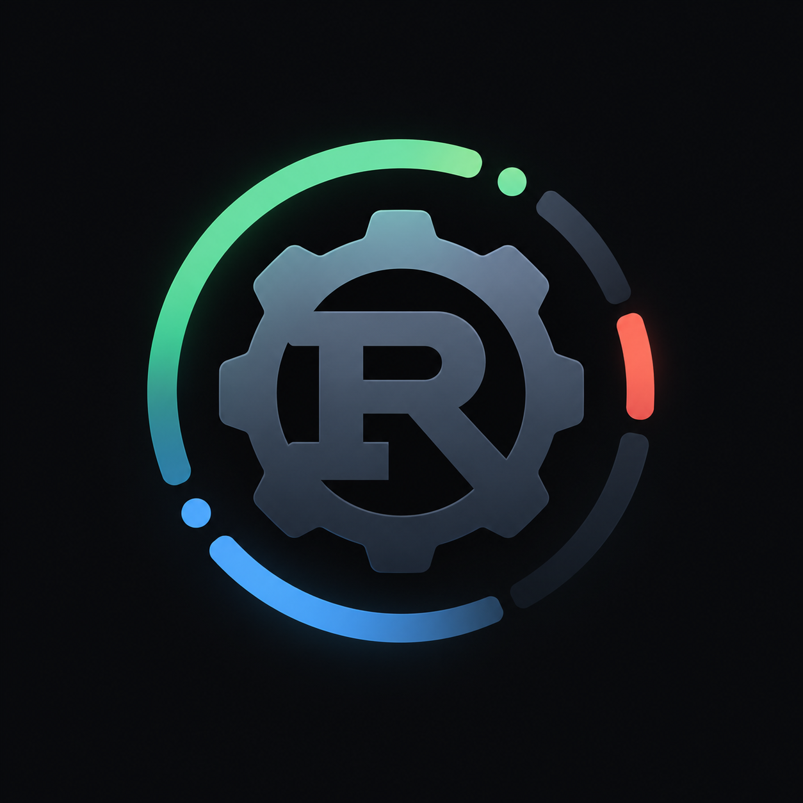
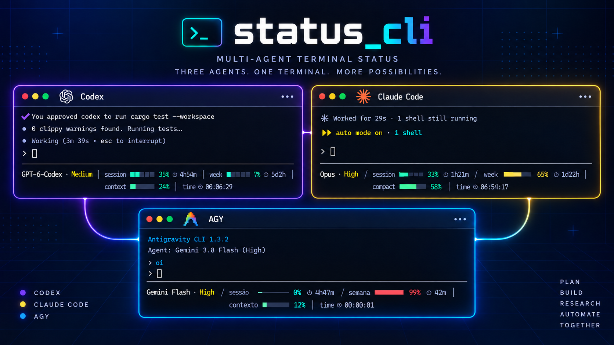

<p align="center">
  
</p>

# status_cli

[](https://github.com/Isllanrx/status_cli/actions/workflows/ci.yml)
[](https://github.com/Isllanrx/status_cli/releases/latest)
[](LICENSE)

Status line for [Claude Code](https://code.claude.com/docs/en/statusline), the
[Antigravity CLI](https://www.antigravity.google/docs/cli/statusline) (`agy`) and the
[Codex CLI](https://github.com/openai/codex): usage limits, context and session time at the bottom of the terminal.
One Rust binary, no runtime, no network calls while it runs.



## Install

Linux and macOS:

```sh
curl -fsSL https://raw.githubusercontent.com/Isllanrx/status_cli/main/install.sh | sh
```

Windows (PowerShell 5.1 or 7):

```powershell
irm https://raw.githubusercontent.com/Isllanrx/status_cli/main/install.ps1 | iex
```

The installer checks the SHA-256, puts the binary in `~/.local/bin`, installs the
[CaskaydiaCove Nerd Font](https://github.com/ryanoasis/nerd-fonts) for the icons (Windows Terminal is switched to it
when it still uses the default Cascadia font; on Linux and macOS pick it in your terminal) and runs
`status_cli setup`, which configures every host it finds (with a `.bak-status_cli` backup). Open a new session
afterwards.

On Windows, run `status_cli setup` once from an elevated PowerShell so that typing `codex` opens Codex with the status
line (it installs `%ProgramFiles%\status_cli\codex.exe` ahead of npm's `codex` in the machine `PATH`).

| Command | What it does |
| --- | --- |
| `status_cli setup` | Configures Claude Code, agy and Codex |
| `status_cli doctor` | Checks the installation; exits with 1 if something is missing |
| `status_cli update` | Installs the latest release after checking its SHA-256 |

## What it shows

```
◆ Modelo       │ ◷ Sessão               │ ▦ Semana       │ ≡ Compactar    │ ◷ Tempo  │
Opus 5.5 High  │ ━━━━────── 40% ↻ 1h29m │ ━━──────── 24% │ ━━━━────── 43% │ 03:25:24 │ By Isllan T.
```

Each segment shows its label above its value on a dark panel (256 colors or more). With the Nerd Font the icons are a
robot, clock, calendar, database and timer and the panel gets rounded ends; without it they fall back to the plain
symbols above and square ends, and to no icons in ASCII mode. On narrow terminals the bars shrink, then the credit,
bars and icons go, then whole columns from the right.

| Segment | Meaning |
| --- | --- |
| Modelo | Model and version as the host reports them, reasoning effort, `· fast` in fast mode |
| Sessão | 5-hour usage. `↻` time to reset, `→` the current pace runs out first, `· Sem Mudança Há 12m` no change for 10+ minutes |
| Semana | Weekly usage. On agy, `Suspensa` when agy says the window does not apply right now |
| Compactar | Claude Code: progress towards auto-compact, using the window from your settings |
| Contexto | Codex and agy: share of the context window in use |
| Tempo | Time since the session window opened |

`–` means the host sent no value. Labels follow the system language (20 languages).

## Configuration

| Variable | Effect |
| --- | --- |
| `STATUS_CLI_LANG` | Language, such as `en`, `pt`, `es`, `zh`, `ja` |
| `STATUS_CLI_COLOR` | `truecolor`, `256`, `16` or `none` |
| `STATUS_CLI_ASCII` | ASCII instead of Unicode glyphs |
| `NO_COLOR` | No colors |
| `STATUS_CLI_ICONS` | `nerd`, `plain` or `none` (default: `nerd` when the Nerd Font is installed) |
| `STATUS_CLI_NO_SHIM` | `setup` leaves `codex` alone |
| `STATUS_CLI_NO_FONT` | The installer skips the Nerd Font |
| `STATUS_CLI_LOG` | Local JSON Lines log of each run |

## More

- [How it works](docs/details.md): host settings, data sources, Codex wrapper, usage sharing, guard hooks, languages
- [Security](SECURITY.md)

## Development

```sh
cargo fmt --check
cargo clippy --all-targets -- -D warnings
cargo test
```

## License

[MIT](LICENSE)
