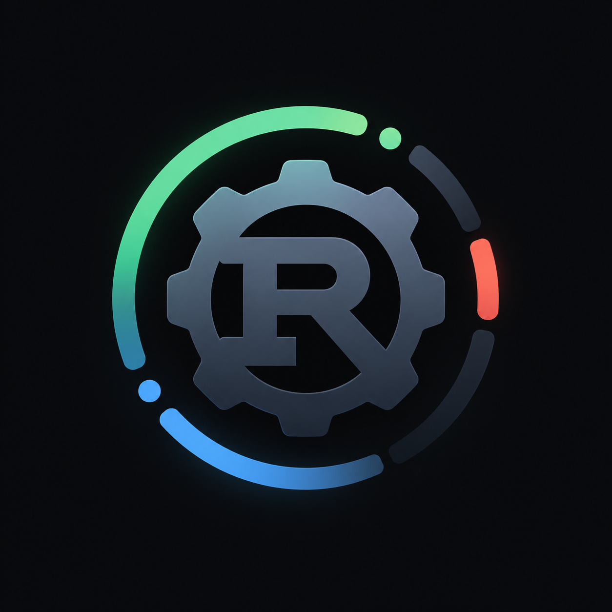
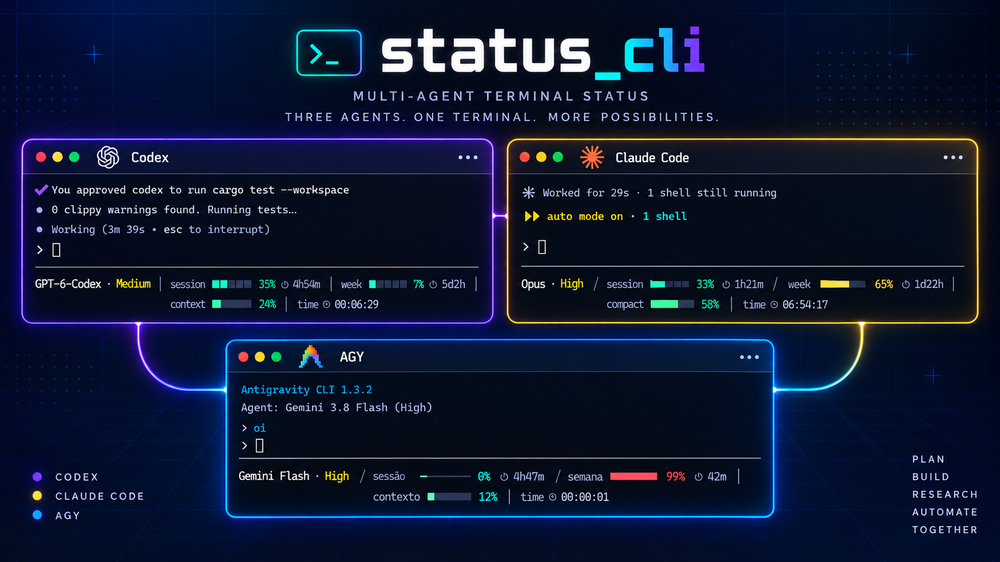

<p align="center">
  
</p>

# status_cli

[](https://github.com/Isllanrx/status_cli/actions/workflows/ci.yml)
[](https://github.com/Isllanrx/status_cli/releases/latest)
[](LICENSE)

A status line for [Claude Code](https://code.claude.com/docs/en/statusline), the
[Antigravity CLI](https://www.antigravity.google/docs/cli/statusline) (`agy`) and the
[Codex CLI](https://github.com/openai/codex). It shows how much of your usage limits you have spent, how close the
conversation is to auto-compact and how long the session has been running, right-aligned at the bottom of the
terminal.



One binary written in Rust, statically linked on Linux. It needs no runtime, makes no network calls and spends
well under a millisecond of its own work per refresh.

## Install

Linux and macOS:

```sh
curl -fsSL https://raw.githubusercontent.com/Isllanrx/status_cli/main/install.sh | sh
```

Windows (PowerShell 5.1 or 7, no administrator needed):

```powershell
irm https://raw.githubusercontent.com/Isllanrx/status_cli/main/install.ps1 | iex
```

The installer picks the binary for your system and architecture, checks its SHA-256 against the release, places it
in `~/.local/bin` and runs `status_cli setup`, which configures every host it finds and keeps a `.bak-status_cli`
copy of each file it changes. On Windows the folder is added to `PATH`; on Linux and macOS the host settings point
at the binary's full path, so `PATH` does not matter. Open a new session afterwards.

`status_cli doctor` checks the result: version, `PATH`, each host's settings and usage hooks, the `codex-stt`
shortcut and the detected terminal and language. It exits with 1 when something is missing.

`status_cli update` moves to the latest GitHub release. It compares the release tag with the running version and stops
if there is nothing newer. Otherwise it downloads that release's binary for your system with `curl`, which ships with
Windows 10 and later, macOS and most Linux distributions. It checks the SHA-256 against the release's `SHA256SUMS`,
makes sure the new binary runs, and only then swaps it in place of the running one. Open sessions pick it up on their
next refresh. On Windows the running binary can't be overwritten, so it is renamed to `status_cli.old`, which the next
update deletes. Errors exit with 1 and leave the installed binary untouched. `STATUS_CLI_RELEASE_URL` (release JSON)
and `STATUS_CLI_BASE_URL` (asset folder) point it at another source, which is how the tests run it against a local
release.

### Install with an AI assistant

Ask Claude Code, Codex, agy or any assistant that can run commands:

> Install status_cli from https://github.com/Isllanrx/status_cli and configure it for me.

The steps it needs are short and safe to repeat:

1. On Linux or macOS run `curl -fsSL https://raw.githubusercontent.com/Isllanrx/status_cli/main/install.sh | sh`;
   on Windows run `irm https://raw.githubusercontent.com/Isllanrx/status_cli/main/install.ps1 | iex` in PowerShell.
2. Run `status_cli doctor` (on Windows, open a new terminal first or call `~/.local/bin/status_cli.exe`) and
   confirm it exits with 0.
3. Tell the user to open a new Claude Code or agy session, or to start Codex with `codex-stt`.

The installer asks no questions, needs no administrator rights and only touches `~/.local/bin` and the host settings,
backing them up first.

To install by hand, download your platform's binary from the
[latest release](https://github.com/Isllanrx/status_cli/releases/latest), save it on `PATH` as `status_cli` and run
`status_cli setup`. To update, run the install command again. To remove it, delete the binary and restore the
`.bak-status_cli` copies.

## Hosts

**Claude Code** runs `status_cli` from `statusLine` in `~/.claude/settings.json` (or `CLAUDE_CONFIG_DIR`) every
second, through Git Bash or PowerShell on Windows. A `statusLine` in a project's `.claude/settings.json` takes
precedence over it. Outside fullscreen mode Claude Code shows notifications on the right of the same row, where they
can cover the end of the line. `subagentStatusLine` uses a different contract and is not supported.

**agy** runs it from `statusLine` in `~/.gemini/antigravity-cli/settings.json`. The clock counts from when the
`agy` window opened: status_cli walks up its parent processes to `agy` and reads that process's start time (Toolhelp
on Windows, `ps` on Linux and macOS). If `agy` isn't among its parents, it counts from the conversation's first
transcript entry instead. agy only runs the command when the agent changes state and has no refresh interval, so while
the agent sits idle the line keeps the last value it drew. Idle time is not lost: the next refresh shows the full
time since the window opened.

**Codex CLI** cannot run an external status line, so status_cli starts Codex for you. Use `codex-stt` wherever
you would type `codex`; arguments pass through unchanged:

```sh
codex-stt
codex-stt --model gpt-6-luna
```

`codex-stt` is a shortcut that setup places next to the binary (`status_cli codex` does the same). Codex runs in a
pseudo-terminal one row shorter than the window (ConPTY on Windows, openpty elsewhere) and the line is drawn on the
last row of the same terminal:

- keys, mouse, paste and resizes pass straight through, and clicks on the status row are ignored;
- the line is only drawn between Codex frames, so it never splits an escape sequence, link or synchronized update;
- Codex's scroll regions are kept off the reserved row, also across alternate-screen switches;
- the data comes from the session this launch started in the current folder (resumed sessions included, sub-agents
  ignored), with limits matched by window length and context computed the way Codex shows it; until Codex writes
  that session, the line shows the configured model and the account's latest limits. Among several `codex-stt`
  launches in the same folder, each one prefers a session created after it started, so two windows don't share a
  session. The clock counts from the later of Codex's session start and the launch, so `codex resume` counts this
  window, not the original session;
- Codex's exit code is returned and the terminal modes are restored even if it crashes.

`status_cli codex --once` prints the line once for tmux status bars or shell prompts. Setup also enables Codex's
native status line in `config.toml`, keeping comments and other settings, for when Codex is started directly.

## What it shows

| Segment | Meaning |
| --- | --- |
| `Opus - High` | Model and reasoning effort as reported by the host, plus `· fast` in fast mode |
| `sessão` | 5-hour usage window. `↻` is the time until it resets; `⇥` appears when the current pace would use it up first |
| `semana` | Weekly usage window, same markers |
| `compactar` | Claude Code only: how far the context is from auto-compact |
| `contexto` | agy and Codex: share of the context window in use |
| `tempo` | Time since the session's window opened |

Each host reports usage from its own last API response, so a terminal that has been idle for a while would show an
older percentage than one in use. status_cli keeps the latest reading of each window in a shared file per host and
account (`usage-claude.json`, `usage-codex.json`, `usage-agy.json` in the cache folder; `CLAUDE_CONFIG_DIR` and
`CODEX_HOME` get their own file). Within a window, usage only goes up, so the highest reading wins. A reading with a
later reset time starts a new window, and expired windows are dropped. Every open terminal then shows the same value,
and a new session shows it before its first response.

Model names and effort levels come straight from the host, so new models need no update. On agy the windows are
those of the current model's family (`gemini-5h` and `gemini-weekly` for Gemini, `3p-…` for third-party models).
Usage limits only exist on subscription plans and appear after the first reply; until then a segment shows `–`.

Claude Code does not send its auto-compact threshold, so `compactar` estimates it the way the documentation
describes it: the auto-compact window minus 33k tokens (about 967k on a 1M window). The window is the model's
context unless `CLAUDE_CODE_AUTO_COMPACT_WINDOW` sets a smaller one, and `CLAUDE_AUTOCOMPACT_PCT_OVERRIDE` can only
bring the threshold down. Values set through `autoCompactWindow` in settings are not read.

## Usage limits for agents

`status_cli setup` also hooks `status_cli guard` into every host, so the agent knows how much of the 5-hour and
weekly limits is used and when each one resets, without being asked:

| Host | Where | When |
| --- | --- | --- |
| Claude Code | `hooks` in `settings.json` | every prompt (`UserPromptSubmit`), and before `Agent`, `Task` or `Workflow` |
| Codex CLI | `~/.codex/hooks.json` | session start and every prompt |
| agy | plugin in `~/.gemini/config/plugins/status_cli/` | session start, and before each model call near the limit |

The agent reads a line such as `status_cli: session 57% (resets in 58m), week 21% (resets in 5d0h).` From 85% of
the session or 90% of the week it is also told to keep its task notes current and to ask before starting subagents
or workflows. From 95% of the session or 97% of the week it is told not to start new tasks: record what is done
and what comes next, tell the user, and stop. In Claude Code, subagents then need confirmation, and are blocked once
the limit is nearly exhausted. Codex has no confirmation step, so it only blocks.

Claude Code and agy are read from the state the status line saves for that session; Codex is read from the session
file Codex itself writes, so it works with or without `codex-stt`. A window that already reset is not reported.
Codex runs only hooks you trust: after `status_cli setup`, approve the new ones once with `/hooks` in Codex.
Running setup again replaces the previous guard entries and leaves every other hook alone.

## Languages

Labels follow the system language, with English for anything else. `STATUS_CLI_LANG` overrides it; otherwise
`LC_ALL`, `LC_MESSAGES` and `LANG` are used, and the Windows display language when those are empty. The first two
letters pick the language, so `pt`, `pt_BR` and `pt-PT` all give Brazilian Portuguese and `zh_TW` gives simplified
Chinese.

| Code | Language | 5-hour window | Weekly window | Auto-compact | Context | Duration |
| --- | --- | --- | --- | --- | --- | --- |
| `en` | English | session | week | compact | context | time |
| `pt` | Portuguese (Brazil) | sessão | semana | compactar | contexto | tempo |
| `es` | Spanish | sesión | semana | compactar | contexto | tiempo |
| `zh` | Chinese (simplified) | 会话 | 本周 | 压缩 | 上下文 | 时长 |
| `hi` | Hindi | सत्र | सप्ताह | संक्षेपण | संदर्भ | समय |
| `ar` | Arabic | الجلسة | الأسبوع | الضغط | السياق | الوقت |
| `fr` | French | session | semaine | compacter | contexte | temps |
| `de` | German | Sitzung | Woche | verdichten | Kontext | Zeit |
| `ja` | Japanese | セッション | 今週 | 圧縮 | コンテキスト | 時間 |
| `ru` | Russian | сессия | неделя | сжатие | контекст | время |
| `ko` | Korean | 세션 | 주간 | 압축 | 컨텍스트 | 시간 |
| `it` | Italian | sessione | settimana | compattare | contesto | tempo |
| `id` | Indonesian | sesi | minggu | ringkas | konteks | waktu |
| `tr` | Turkish | oturum | hafta | sıkıştır | bağlam | süre |
| `vi` | Vietnamese | phiên | tuần | nén | ngữ cảnh | thời gian |
| `th` | Thai | เซสชัน | สัปดาห์ | บีบอัด | บริบท | เวลา |
| `bn` | Bengali | সেশন | সপ্তাহ | সংকোচন | প্রসঙ্গ | সময় |
| `ur` | Urdu | سیشن | ہفتہ | کمپیکٹ | سیاق | وقت |
| `pl` | Polish | sesja | tydzień | kompaktowanie | kontekst | czas |
| `nl` | Dutch | sessie | week | compacteren | context | tijd |

Chinese, Japanese and Korean characters count as two columns and combining marks (Thai, Hindi, Bengali, Arabic
vowel signs) as none, so the line keeps its width. Arabic and Urdu are written in logical order; how they read
depends on the terminal's right-to-left support. The guard's messages to the agent use the same language.

## Configuration

Everything works out of the box. These environment variables change the defaults:

| Variable | Effect |
| --- | --- |
| `STATUS_CLI_COLOR` | `truecolor`, `256`, `16` or `none`, for terminals that do not advertise their depth (tmux, screen) |
| `STATUS_CLI_ASCII` | ASCII instead of Unicode glyphs |
| `STATUS_CLI_LANG` | Language code from the table above, such as `en`, `pt`, `zh`, `ja` or `ar` |
| `NO_COLOR` | No colors |
| `STATUS_CLI_LOG` | JSON Lines log with per-phase timings, host, model, effort and the rendered line |
| `STATUS_CLI_CODEX` | Program to run instead of `codex` in `codex-stt` |

## Compatibility

Colors and glyphs adapt to the terminal: 24-bit color where it is advertised (Windows Terminal, iTerm2, WezTerm,
Ghostty, Kitty, Alacritty, Konsole, GNOME Terminal and other VTE terminals), 256 colors on Terminal.app, tmux and
PuTTY, and 16 colors with ASCII glyphs on the Linux console. Under CJK locales box drawing falls back to ASCII,
since those terminals draw it double width. The line never exceeds the terminal width.

Every release runs the binary through cmd, PowerShell 5.1 and 7, Git Bash, sh, dash, bash, zsh, ksh, tcsh, fish and
nushell on Windows, Linux and macOS (x64 and ARM), inside Ubuntu, Debian, Arch, Fedora, Alpine, openSUSE, Rocky and
Amazon Linux containers, and installs it from the published release on each platform.

## Performance

| | Linux | Windows |
| --- | --- | --- |
| Process start to exit | 0.6 ms | 5.5 ms |
| Time spent in status_cli | 0.07 ms | 0.18 ms |

Most of the Windows figure is the operating system creating the process. State is one small file per session in
`status_cli/` under `XDG_RUNTIME_DIR`, `%LOCALAPPDATA%`, `XDG_CACHE_HOME` or `~/.cache`, read once per refresh,
written only when something changes and removed after seven days.

## Development

```sh
cargo fmt --check
cargo clippy --all-targets -- -D warnings
cargo test
cargo llvm-cov --summary-only
```

The code is split by slice, and each slice owns its parsing, rendering and tests:

| Folder | Contents |
|---|---|
| `src/statusline/` | Line segments (`model`, `context`, `quota`, `clock`) and the width-based `layout` |
| `src/statusline/clock/` | Session clock and the process lookup that dates the agy window |
| `src/codex/` | Codex rollout reader; `wrap/` runs Codex inside a pseudo-terminal |
| `src/usage/` | Usage shared across terminals and the `guard` hook |
| `src/install/` | `setup`, `doctor`, host hooks and `update` |
| `src/shared/` | Host payload, session state, time parsing and telemetry |
| `src/render/` | Colors, gauges and terminal capabilities |
| `src/i18n/` | Labels in every language |

The suite has unit tests beside each module and one integration crate per slice in `tests/`, sharing `tests/common/`:
`statusline` (`cli` rendering, `matrix` with every model, effort and mode, `i18n` with every language, `regression`
with one test per fixed bug), `codex` (`reader`, and `wrap` with Codex inside a real pseudo-terminal), `install`
(`setup`, `update`, and `e2e`, which installs, configures and runs the configured command through the host's shell)
and `usage` (`guard` hooks and their registration). CI runs them on every platform and reports coverage.

Releases are automatic. Every push to `main` that changes `src/`, `Cargo.toml` or `Cargo.lock`
since the last `vX.Y.Z` tag ships the next minor version: `v1.1.0` becomes `v1.2.0`. CI writes that number into
`Cargo.toml` and `Cargo.lock` inside the runner before building, so nothing is committed back. The `version` in
`Cargo.toml` is a floor: raise it by hand for a major or a specific version, and CI uses it when it's higher. Pushes
that only touch docs or CI don't release. Once every test, shell and distro check passes, CI tags the commit,
publishes the binaries with `SHA256SUMS` and installs them on each platform. Local builds report the `Cargo.toml`
version, which can trail the latest release.

## License

[MIT](LICENSE)
